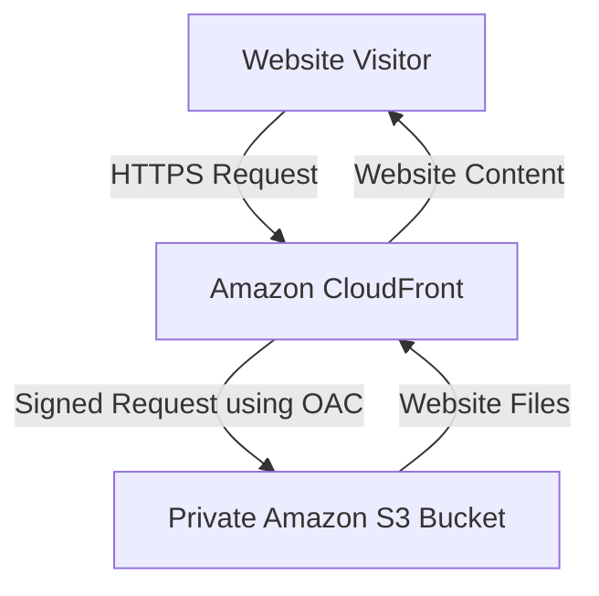
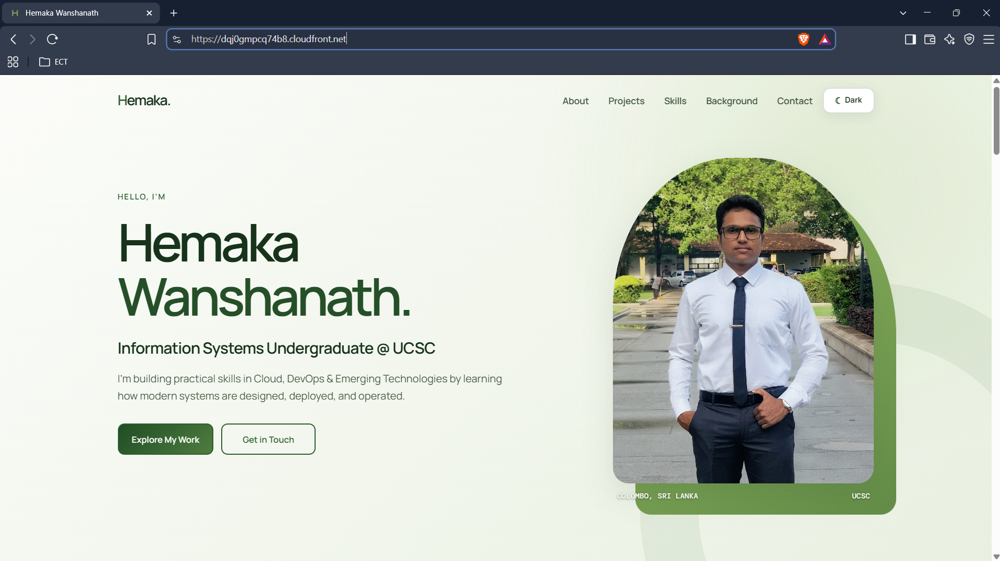
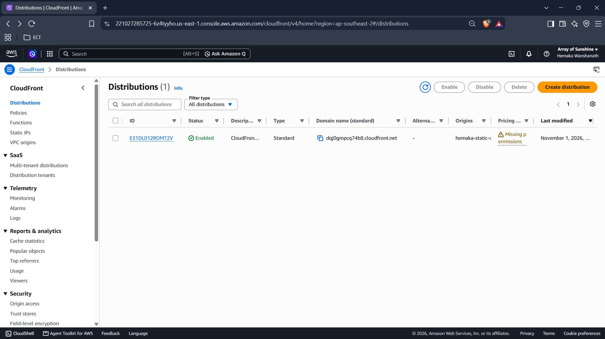
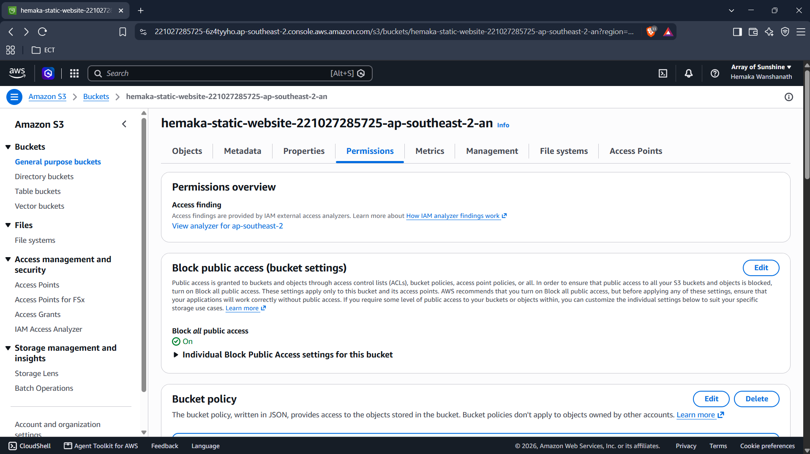
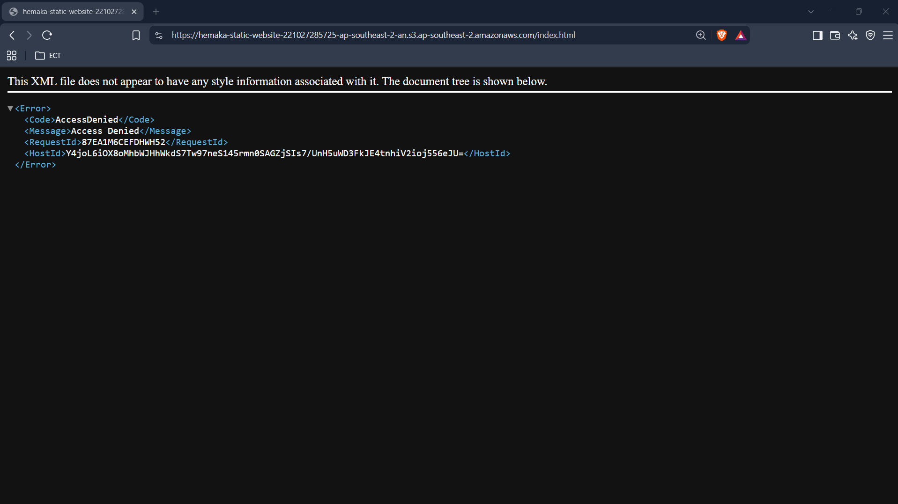
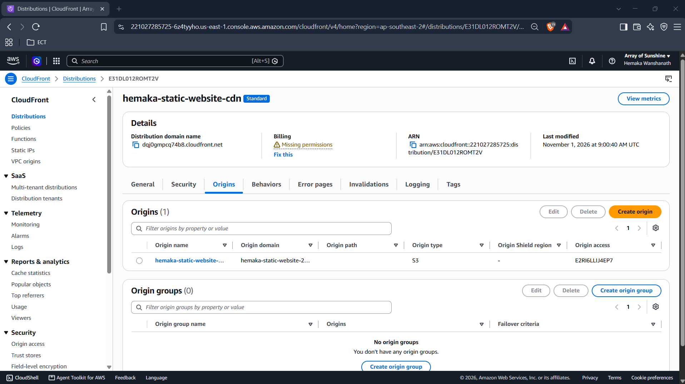
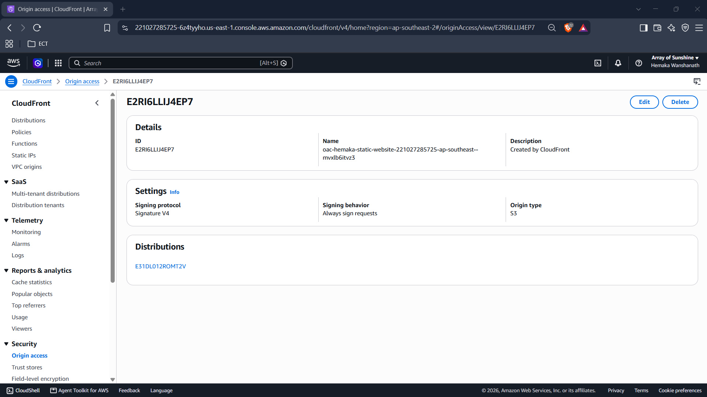

# AWS Static Website Hosting with Secure Content Delivery

A beginner AWS project demonstrating static website hosting using Amazon S3 and secure content delivery through Amazon CloudFront.

## Project Overview

The goal of this project was to deploy a static website on AWS while keeping the S3 bucket private.

Amazon CloudFront serves the website to visitors over HTTPS, while Origin Access Control (OAC) allows CloudFront to securely retrieve website files from the private S3 bucket.

## Live Demo

**Website:** https://dqj0gmpcq74b8.cloudfront.net

## Architecture

## AWS Services Used

| AWS Service | Purpose |
|---|---|
| Amazon S3 | Stores static website files |
| Amazon CloudFront | Delivers website content globally |
| CloudFront Origin Access Control | Authenticates CloudFront requests to the private S3 origin |

## Security Configuration

- S3 Block Public Access enabled.
- S3 bucket kept private.
- CloudFront Origin Access Control configured.
- OAC uses Signature Version 4 and always signs requests.
- CloudFront granted access to the S3 origin.
- Direct public access to the S3 object tested and returned `AccessDenied`.
- Website delivered through the CloudFront HTTPS URL.

## Deployment Details

| Configuration | Value |
|---|---|
| S3 Region | Asia Pacific (Sydney) – `ap-southeast-2` |
| CloudFront Distribution | Enabled |
| Default Root Object | `index.html` |
| Origin Type | Amazon S3 |
| Origin Access | Origin Access Control (OAC) |
| Distribution URL | https://dqj0gmpcq74b8.cloudfront.net |

## Website Technologies

- HTML
- CSS
- JavaScript
- JSON

## Deployment Screenshots

### 1. Live Website

### 2. CloudFront Distribution

### 3. S3 Block Public Access

### 4. Direct S3 Access Denied

### 5. CloudFront Origin Configuration

### 6. CloudFront OAC Configuration

## Verification

The following checks were performed:

- Website successfully loads through CloudFront.
- Website styling and images load correctly.
- Navigation and JavaScript functionality work.
- Projects section loads.
- Direct access to an S3 object is denied.
- CloudFront can retrieve website content from the private S3 bucket.

## Cost Considerations

This project uses the CloudFront Pay-as-you-go billing model. Charges may apply depending on storage, requests and data transfer.

Optional services such as AWS WAF and custom domain configuration were not enabled.

## Future Improvements

- Automate website deployment using GitHub Actions.
- Integrate GitHub Actions with AWS using OpenID Connect (OIDC).
- Configure a custom domain and HTTPS certificate.
- Explore additional monitoring and security features.

## Learning Outcomes

Through this project, I gained practical experience with:

- Static website hosting using Amazon S3.
- Amazon CloudFront distribution configuration.
- Private S3 origin access using OAC.
- CloudFront default root object configuration.
- Basic AWS security and deployment verification.

---

**Project Status:** Core website deployment completed. Further improvements are planned.